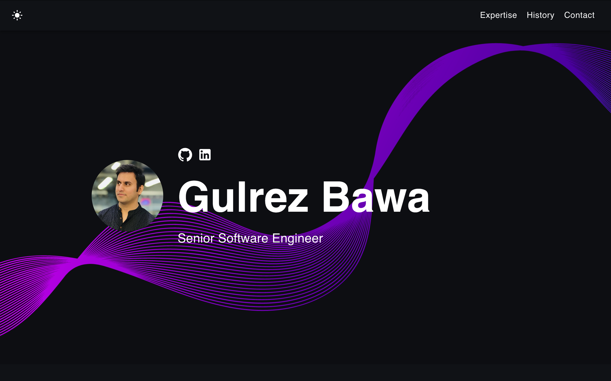

# Gulrez Bawa – Developer Portfolio 🚀


## Overview

This is my personal portfolio website to showcase my work, professional experience, skills, and personal projects.



## Features

✅ Responsive and mobile-friendly design  
✅ Dark & light mode support  
✅ Modern, multi-component layout  
✅ Built with React, TypeScript, JavaScript, and SCSS

## Local Setup

1. Make sure you have [Node.js](https://nodejs.org/) installed:

   ```bash
   node -v
   ```

2. Install dependencies:

   ```bash
   npm install
   ```

3. Start the development server:

   ```bash
   npm start
   ```

4. Open [http://localhost:3000](http://localhost:3000) in your browser.

## Customization

- All texts, images, and content can be edited in the `/src/components` directory.
- Update skills, experience, and project details as needed.

## Deployment

This portfolio is deployed via [Netlify](https://www.netlify.com/) and linked to my custom domain.
